# Vigil

**An AI-assisted clinical evidence review prototype for medical devices.**

Vigil helps structure the literature-review work behind a Clinical Evaluation
Report (CER): it turns a device profile and approved search strategy into a
traceable search, screens and appraises evidence, and assembles a reviewable
document set. It is built as a Python and Streamlit application.

> **Prototype, not a regulatory decision-maker.** Vigil generates drafts and
> organizes evidence. It does not determine device safety, performance,
> equivalence, benefit-risk acceptability, or regulatory conformity. A qualified
> clinical evaluator and the manufacturer's Person Responsible for Regulatory
> Compliance (PRRC) must review, complete, and approve every output. This project
> is not validated for production or for use as a standalone regulatory tool.

## What it does

- Builds two PubMed search tracks from a structured device profile: one for
  device-specific evidence and one for the state of the art.
- Lets the reviewer inspect and edit search strings, preview hit counts, approve
  the final queries, and lock the evaluation scope before searching.
- Searches PubMed and ClinicalTrials.gov; also accepts optional RIS exports from
  subscription databases such as Embase or Cochrane.
- Deduplicates records across sources and screens abstracts against the
  review's inclusion and exclusion criteria.
- Retrieves legally open-access full text from PubMed Central (PMC) and
  Unpaywall when available. It checks retrieved documents against DOI or title
  information and routes unverified or unavailable documents for reviewer
  follow-up rather than treating them as confirmed evidence.
- Uses Anthropic Claude models for abstract screening, preliminary extraction,
  full-text appraisal, and CER narrative drafting.
- Tracks run state, approved queries, scope identifiers, and review events in
  SQLite to support traceability within a run.
- Generates PRISMA 2020 flow information and assembles a downloadable document
  set for human review.

## Review workflow

1. **Define the device and review scope.** Enter device details, clinical
   questions, criteria, and evaluator information.
2. **Review the search strategy.** Inspect or edit the two PubMed queries and
   preview result counts.
3. **Approve and lock the scope.** Locking freezes the approved queries and
   scope for the evaluation.
4. **Search and screen.** Vigil searches the configured sources, deduplicates
   records, screens abstracts, and performs preliminary extraction.
5. **Retrieve and appraise full text.** Available open-access texts are checked
   for identity; verified texts and reviewer-uploaded PDFs are sent through
   full-text appraisal. Papers without appraised full text remain visibly
   incomplete.
6. **Review and download the document set.** The reviewer can download each
   output separately or as a ZIP archive.

```mermaid
flowchart LR
    A[Device profile] --> B[Review and approve searches]
    B --> C[PubMed + ClinicalTrials.gov]
    B -. optional RIS exports .-> C
    C --> D[Deduplicate and screen]
    D --> E[Open-access retrieval]
    E --> F[DOI/title identity check]
    F --> G[Full-text appraisal]
    F -. unavailable or unverified .-> H[Reviewer PDF upload]
    H --> G
    G --> I[PRISMA and traceable document set]
```



## Generated outputs

The document set contains:

1. Clinical Evaluation Plan (CEP)
2. Literature Search Protocol
3. Literature Search Report, including PRISMA flow information
4. CER first draft
5. Evidence Traceability Matrix
6. Audit Trail (CSV)

The five narrative documents are exported as Word files. Each carries run and
scope information and a visible draft/reviewer disclaimer; the audit trail is
provided as CSV. Vigil marks regulatory judgments that require human completion
instead of presenting them as AI conclusions.

## Technology

- Python 3.10+
- Streamlit
- SQLite
- Anthropic Python SDK and Claude models
- NCBI E-utilities / PubMed
- ClinicalTrials.gov API
- PubMed Central and Unpaywall for open-access retrieval
- `python-docx` for Word exports

## Run locally

### Requirements

- Python 3.10 or newer
- An Anthropic API key for live AI-powered review steps
- Internet access for live PubMed, ClinicalTrials.gov, PMC, and Unpaywall requests

### Install and start

```bash
git clone https://github.com/<your-username>/<your-repository>.git
cd <your-repository>

python -m venv .venv
source .venv/bin/activate       # Windows: .venv\Scripts\activate

python -m pip install --upgrade pip
python -m pip install -r requirements.txt
cp .env.example .env
```

Edit `.env` and set `ANTHROPIC_API_KEY`. For NCBI and Unpaywall requests, set
the relevant contact email variables described below. Then run:

```bash
streamlit run app.py
```

Open the local URL printed by Streamlit. The app is configured to use port 8080
by default.

Keep `.env` private. It is listed in `.gitignore`; never commit API keys or other
credentials.

## Configuration

| Variable | Required | Purpose |
|---|---:|---|
| `ANTHROPIC_API_KEY` | Yes for AI steps | Authenticates requests to the Anthropic API. |
| `NCBI_EMAIL` | Recommended | Contact email for NCBI E-utilities requests. |
| `NCBI_API_KEY` | No | Optional NCBI key for a higher request rate. |
| `UNPAYWALL_EMAIL` | Recommended for retrieval | Contact email used for Unpaywall requests; defaults to `NCBI_EMAIL`. |
| `VIGIL_AUTO_RETRIEVAL` | No | Set to `0` to disable automatic PMC/Unpaywall retrieval. Defaults to enabled. |
| `VIGIL_COMPREHENSIVE` | No | Set to `1` to opt into comprehensive retrieval instead of the default capped demo run. |
| `VIGIL_DB` | No | SQLite database path. Defaults to `vigil.db`. |

Additional model, retrieval, and processing limits can be adjusted through the
`VIGIL_*` settings in `config.py`. Comprehensive searches and larger screening
runs can increase API usage and cost; review the configuration before running
them.

## Offline demo and tests

The offline pipeline demo uses canned records and stubbed AI/retrieval calls. It
does not require API keys or live service access. It does use ReportLab to
generate test PDFs:

```bash
python -m pip install reportlab
python tests/offline_demo.py
```

The test scripts are designed to run without live API calls. To run them all:

```bash
python -m pip install reportlab
for test in tests/test_*.py; do
  python "$test" || exit 1
done
```

## Project structure

| Area | Responsibility |
|---|---|
| `app.py`, `ui_theme.py` | Streamlit review wizard and presentation |
| `device_profile.py`, `config.py` | Review inputs and application configuration |
| `pipeline.py` | Search, screening, retrieval, and appraisal orchestration |
| `pubmed.py`, `clinicaltrials.py`, `ris_ingest.py` | Evidence-source clients and RIS import |
| `screen.py`, `extract.py`, `appraise.py`, `llm.py` | AI-assisted evidence processing |
| `retrieve.py`, `verify.py` | Open-access retrieval and document identity checks |
| `db.py` | SQLite run state, evidence records, and event log |
| `outputs.py`, `draft.py`, `prisma.py`, `docx_export.py` | Reports, CER content, PRISMA flow, and Word export |
| `prompts/` | Versioned prompts used by the AI workflows |
| `tests/` | Offline checks and demo pipeline |

## Scope and data handling

Vigil is a single-user prototype. It does not include sign-in, multi-tenant
access controls, or production-grade data retention and deployment controls.
SQLite is used for run data; do not treat this prototype as durable storage.

Live AI steps send the relevant device-profile information, bibliographic
metadata, abstracts, or full-text content to Anthropic. Live searches and
retrieval contact external services including NCBI, ClinicalTrials.gov, and
Unpaywall. Do not submit confidential, personal, or otherwise sensitive
information unless you have reviewed the applicable provider terms and have
authorization to do so.

Vigil only attempts to retrieve open-access full text; it is not designed to
bypass publisher paywalls. The reviewer is responsible for source selection,
search completeness, appraisal, interpretation, and final regulatory decisions.

## License

No license file is currently included. Public visibility on GitHub does not by
itself grant permission to reuse, modify, or distribute this project's code.
